<!--
Conventions (see CLAUDE.md):
- Every set of clicks goes in a step box: ::: callout-note with a "## Where: what" title
  ("In QualCoder: ...", "In Finder: ...", "In File Explorer: ...", "In your browser: ...").
  Explanation stays outside the boxes.
- Where Mac and Windows differ, use ::: {.panel-tabset group="os"} with "### Mac" and
  "### Windows" tabs (in that order), each holding its own step box and screenshot.
- After the steps, only "Gotcha: ..." (callout-warning) and "Extra: ..." (callout-tip) callouts.
- Questions for the room are blockquotes.
- [text]{.tbd} marks anything not yet known; ::: {.placeholder} marks a picture still to take
  or content still to come. Neither should appear in a released version.
- Sources: sources/QualCoder v3.8.2 - Quick Start User Guide.docx and sources/Intro to
  QualCoder.pptx. Changes and decisions are logged in planning/session-outline.md.
-->

::: {.golink}
[Open this guide anywhere:]{.golink-label}
[[go.ncsu.edu/dss-intro-qualcoder]{.tbd}](#)
:::

::: callout-important
## How to use this guide

This is the page we work from in the session. Every step is written out, so you can follow along,
catch up if you fall behind, and come back to it later.

- **Steps are in purple boxes** titled with where you do them: *In your browser*, *In Finder*
  (Mac), *In File Explorer* (Windows) or *In QualCoder*. Everything outside a box explains what
  the steps do.
- **Mac and Windows steps are in tabs.** Where the two differ, pick your system's tab once and
  every tab on the page switches to match.
- **This guide is for QualCoder version 3.8.2.** There is a version 4.0, but it is very new and
  some of its menus have changed.
:::

# Welcome {.unnumbered}

## What you'll be able to do {.unnumbered}

- Install QualCoder and set up a project folder that keeps your data and backups safe.
- Create a QualCoder project and import interview transcripts into it.
- Code transcripts, and add memos and annotations as you go.
- Run reports of your coded text and memos to start your analysis.

## Roadmap for today {#sec-roadmap .unnumbered}

1. **See where we're headed.** We start with a look at a finished project, below.
2. **Set up a project folder** on your computer and download today's transcripts into it
   (@sec-folders).
3. **Install QualCoder** (@sec-install).
4. **Create a QualCoder project**, set your coder name and turn on backups (@sec-project).
5. **Import transcripts** and describe them with attributes (@sec-import).
6. **Code**: watch a short demo, then code a transcript yourself for 5 minutes (@sec-coding).
7. **Run reports** of coded text and memos (@sec-reports).
8. **Close the project**, then reopen it to find your first backup (@sec-close).

More things to try, including how to work on a project with a team, are in
[Extra activities](#sec-extras).

### What we're not doing today {.unnumbered}

- **We're not using QualCoder's AI features.** QualCoder can connect to AI tools, but sending
  research data to an AI service has IRB implications. Always check with your advisor and your
  IRB protocol before turning them on.
- **We're not covering how to do qualitative research.** Today is about the software: how to
  set up a project and use QualCoder's tools.

### Where we're headed {.unnumbered}

By the end of the session you'll have a project that looks like this: three interviews with
singers, coded with a few codes (each has its own color), a memo or two, and a report that pulls
together everything you coded in the interviews.

::: {.placeholder}
**Screenshot: `images/roadmap-end-result.png`.** The Coding tab of a finished workshop project:
the codes list on the left with 2–5 codes in their colors, a transcript on the right with several
passages highlighted, at least one passage underlined (2+ codes) and one italicized (memo). Take it after the demo
transcripts have been coded.
:::

{fig-alt="QualCoder's Reports tab. All three transcripts and all four codes are selected on the left: Faith/spirituality, Industry pushback, Inspiration from life and Why it connects, with their counts. On the right, the report lists each coded passage under a heading in its code's color, with the file name and coder."}

------------------------------------------------------------------------

# Set up your project folder {#sec-folders}

Before you install QualCoder, decide where your project will live and make a folder for it. A
QualCoder project is a folder ending in `.qda` that holds a database of your codes, memos and
copies of your files. Keeping it in a folder of its own, next to your original data and your
backups, makes the project easy to find, copy and hand on.

::: {.callout-warning .critical}
## Gotcha: don't use cloud storage for the project folder

Don't put the project folder in OneDrive, Google Drive, Dropbox, Box or iCloud. QualCoder keeps
its database open while you work, and a sync program copying it at the same time can damage it or
create conflicting copies.

Watch out for folders that sync without you noticing: on a Mac, **Desktop** and **Documents**
may be synced to iCloud; on Windows, they may be synced to OneDrive. Your home folder is usually
a safe place. Back up by copying the closed project somewhere else, not by syncing it.
:::

You'll make a folder called `qualcoder-workshop` with two folders inside it: `data`, for your
original interview files, and `backups`, for QualCoder's automatic backups. Later, QualCoder adds
the project itself, `intro-qc-workshop.qda`, next to them (@sec-project).

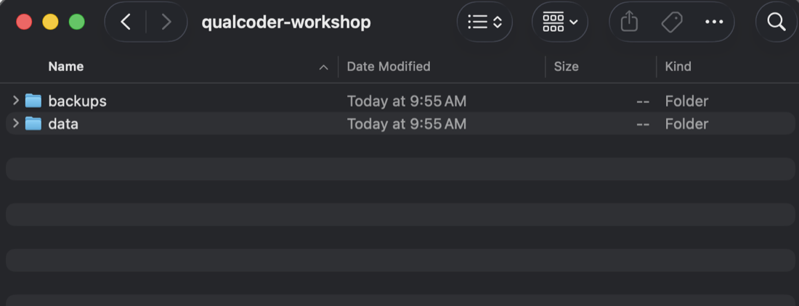{fig-alt="A Finder window titled qualcoder-workshop, in list view, containing two folders: backups and data." width="70%"}

::: {.panel-tabset group="os"}

### Mac

::: callout-note
## In Finder: make the project folders

1. Open **Finder** and go to your home folder: **Go > Home** (or **Cmd + Shift + H**).
2. Make a new folder (**File > New Folder**, or **Cmd + Shift + N**) and name it
   `qualcoder-workshop`.
3. Open `qualcoder-workshop` and make two folders inside it: `data` and `backups`.
:::

### Windows

::: callout-note
## In File Explorer: make the project folders

1. Open **File Explorer** and go to your user folder: `C:\Users\<your name>`. (Not
   **Documents** or **Desktop**, which may sync to OneDrive.)
2. Make a new folder (**New > Folder**, or **Ctrl + Shift + N**) and name it
   `qualcoder-workshop`.
3. Open `qualcoder-workshop` and make two folders inside it: `data` and `backups`.
:::

:::

## Get today's transcripts {#sec-data}

Today we'll code three interviews with singers, from the Library of Congress. Each was done when one
of the singer's recordings was added to the [National Recording
Registry](https://www.loc.gov/programs/national-recording-preservation-board/recording-registry/),
and each singer answers similar questions: where the songs came from, how the record got made and
why it still connects with people. That overlap makes them good for coding: the same ideas come
up in all three, in different words.

| Singer | Recording | Interview | Length |
|--------|-----------|-----------|--------|
| Dolly Parton | "Coat of Many Colors" (1971) | 2016 | about 850 words |
| Cyndi Lauper | *She's So Unusual* (1983) | 2019 | about 1,600 words |
| Alicia Keys | *Songs in A Minor* (2001) | 2022 | about 2,350 words |

**Our research question for today:** *How do singers describe where their songs come from, and
why those songs connect with people?* A real study would start from a question like this; we use
it to decide what to code.

These three come from the Library of Congress's [index of Recording Registry
interviews](https://www.loc.gov/programs/national-recording-preservation-board/recording-registry/index-of-interviews/),
which has interviews with more than 100 other musicians, producers and songwriters, as PDFs.

::: callout-note
## In your browser: download the interviews

1. Click each link to download the interview as a text file:
   - [DollyParton.txt](data/DollyParton.txt){download="DollyParton.txt"}
   - [CyndiLauper.txt](data/CyndiLauper.txt){download="CyndiLauper.txt"}
   - [AliciaKeys.txt](data/AliciaKeys.txt){download="AliciaKeys.txt"}
2. If a file opens in your browser instead of downloading, go back, then right-click the link
   (on a Mac, Control-click) and choose **Download Linked File** or **Save link as**.
3. Move the three files from your **Downloads** folder into `qualcoder-workshop/data`.
:::

The Library of Congress shares the interviews as PDFs, and they weren't made for analysis: every
line ends in a line break, even mid-sentence, and the interviewer is labeled "LOC", "Library of
Congress" or "LC". For today, we've made plain-text copies with only the formatting tidied: each
paragraph is joined back together, and the speakers are always labeled "Library of Congress:" and
the singer's name. The words are unchanged, including the editors' notes in [square brackets].

Ideally, transcripts are **clean** like this before you import them: speaker labels consistent,
typos fixed, and names and identifying details removed if the participants were promised
confidentiality. QualCoder imports plain text (`.txt`), Word (`.docx`) and PDF files.

::: callout-tip
## Extra: who owns an interview?

The interviews are copyrighted by their authors. The Library of Congress's license lets it allow
noncommercial scholarly and educational reuse, and it gave us permission to share these text
copies for this workshop. Each file starts with a note saying so. When you reuse someone else's
interviews in your research, check the license and the terms of use first.
:::

# Install QualCoder {#sec-install}

QualCoder is free, open-source software for qualitative data analysis. It runs on your own
computer, so your data stays with you. If you installed it before the session, check that it
opens and skip ahead to @sec-project.

::: callout-warning
## Gotcha: the newest QualCoder is 4.0, but we use 3.8.2

QualCoder 4.0 came out in October 2026, so QualCoder's website now offers 4.0, and its menus
differ from this guide. Use the download links below to get 3.8.2.
:::

::: {.panel-tabset group="os"}

### Mac

::: callout-note
## In your browser and Finder: install on a Mac

1. Download
   [QualCoder_3_8_2_macOs_arm64.dmg](https://github.com/ccbogel/QualCoder/releases/download/3.8.2/QualCoder_3_8_2_macOs_arm64.dmg)
   (547 MB).
2. Open the downloaded file from your **Downloads** folder.
3. [Drag **QualCoder** into your **Applications** folder]{.tbd}.
4. Open QualCoder from **Applications**. If your Mac says it can't check the app for malicious
   software, go to **System Settings > Privacy & Security**, scroll down and click
   **Open Anyway** [confirm the exact message and steps]{.tbd}.
:::

::: callout-warning
## Gotcha: 3.8.2 is for Apple silicon Macs only

The 3.8.2 Mac download runs only on Macs with Apple silicon (M1 or later). To check yours, open
the **Apple menu > About This Mac**: it lists a **Chip** (Apple M1, M2, ...) or a **Processor**
(Intel). There's no Intel version of 3.8.2; the most recent Intel Mac version is
[3.7](https://github.com/ccbogel/QualCoder/releases/tag/3.7)
(`QualCoder.3.7.Mac.X86.dmg`), and some menus may differ from this guide.
:::

### Windows

::: callout-note
## In your browser and File Explorer: install on Windows

1. Download
   [QualCoder_3_8_2_Win_setup.exe](https://github.com/ccbogel/QualCoder/releases/download/3.8.2/QualCoder_3_8_2_Win_setup.exe)
   (246 MB).
2. Find the setup wizard in your **Downloads** folder and double-click it to start.
3. When asked, choose **Download only for me** [confirm the exact wording]{.tbd}. On university
   computers you can't install it for all users.
4. [Click through the rest of the wizard: list each button, such as **Next**, **Install** and
   **Finish**]{.tbd}.
5. Let the setup wizard open QualCoder when the installation is complete.
:::

:::

## The first time QualCoder opens

::: callout-note
## In QualCoder: the first time it opens

1. Wait. QualCoder is not very quick to open.
2. When it asks whether you want to set up AI, click **No**. You can always set it up later.
:::

# Create a QualCoder project {#sec-project}

## Menus and tabs

QualCoder has two ways to get around, and this guide uses both:

- **The top menu**: **Project**, **Manage**, **Coding**, **Reports**, **AI** and **Help**. On a
  Mac, it's in the menu bar at the top of the screen, after the **Qualcoder** menu. On Windows,
  it's at the top of the QualCoder window.
- **The tabs** inside the QualCoder window: **Action Log**, **Manage**, **Coding**, **Reports**
  and **AI Chat**. Choosing an item from the top menu often opens one of these tabs.

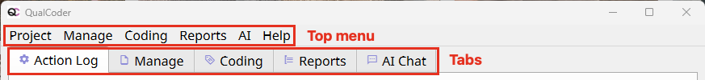{fig-alt="The top of the QualCoder window on Windows. A red box labeled Top menu surrounds Project, Manage, Coding, Reports, AI and Help. Below it, a red box labeled Tabs surrounds Action Log, Manage, Coding, Reports and AI Chat." width="80%"}

## Create the project

::: {.panel-tabset group="os"}

### Mac

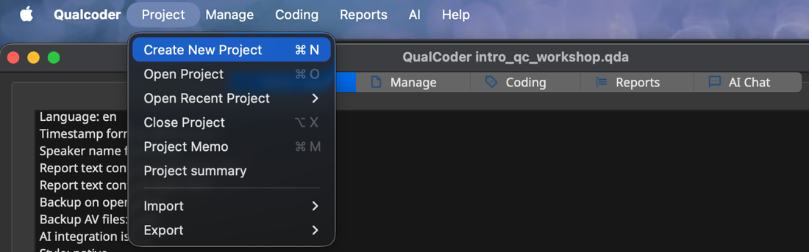{fig-alt="QualCoder's Project menu open in the Mac menu bar, with Create New Project (Command N) highlighted, above Open Project, Open Recent Project, Close Project (Option X), Project Memo, Project summary, Import and Export. Behind it is the QualCoder window with its tabs: Manage, Coding, Reports and AI Chat."}

::: callout-note
## In QualCoder: create a new project

1. Go to **Project > Create New Project** (or **Cmd + N**).
2. In the save window, go to your `qualcoder-workshop` folder.
3. Name the project `intro-qc-workshop` and click **Save**. QualCoder adds `.qda` to the name.
4. The project opens right away in QualCoder.
:::

### Windows

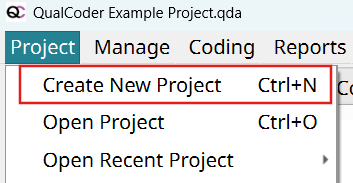{fig-alt="QualCoder's Project menu open, with Create New Project (Ctrl+N) boxed in red, above Open Project and Open Recent Project." width="60%"}

::: callout-note
## In QualCoder: create a new project

1. Go to **Project > Create New Project** (or **Ctrl + N**).
2. In the save window, go to your `qualcoder-workshop` folder.
3. Name the project `intro-qc-workshop` and click **Save**. QualCoder adds `.qda` to the name.
4. The project opens right away in QualCoder.
:::

:::

## Set your coder name

QualCoder records who coded each passage. Set your name now, so your codes are labeled with it.
This is especially important when you check coding between coders or team members, to make sure
codes are applied consistently.

The settings are in a different menu on each system.

::: {.panel-tabset group="os"}

### Mac

::: callout-note
## In QualCoder: open the settings

1. Go to **Qualcoder > Preferences...** (or **Cmd + ,**). On a Mac, the settings are in the
   **Qualcoder** menu, not the **Project** menu.
:::

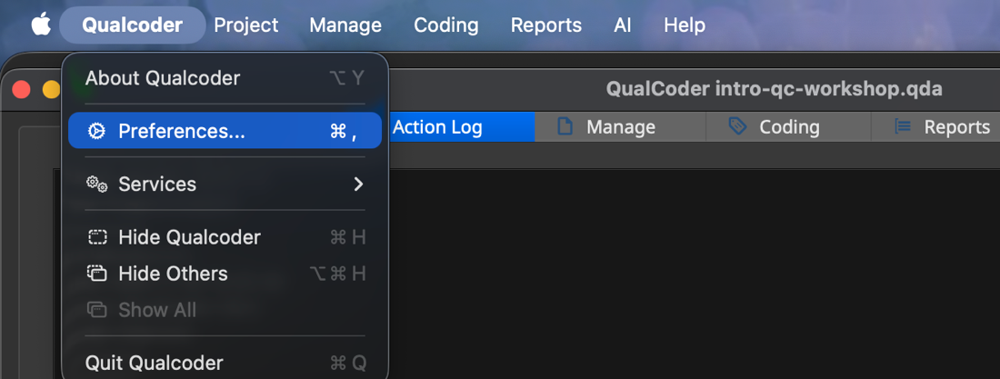{fig-alt="The Qualcoder menu open in the Mac menu bar, with Preferences (Command comma) highlighted. The menu also lists About Qualcoder, Services, Hide Qualcoder, Hide Others, Show All and Quit Qualcoder (Command Q)."}

### Windows

::: callout-note
## In QualCoder: open the settings

1. Go to **Project > Settings** (or **Alt + S**).
:::

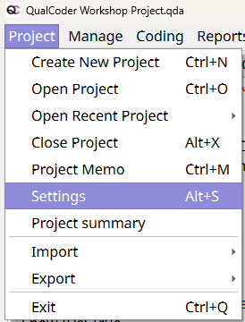{fig-alt="QualCoder's Project menu open with Settings (Alt+S) highlighted. The menu also lists Create New Project, Open Project, Open Recent Project, Close Project, Project Memo, Project summary, Import, Export and Exit." width="50%"}

:::

The Settings window and the coder list are the same on both systems.

::: callout-note
## In QualCoder: set your coder name

1. Next to **Current coder**, click **Change**.
2. Click **New**, type your coder name and click **OK**.
3. Make sure your coder name has a check mark next to it.
4. Click **OK**.
:::

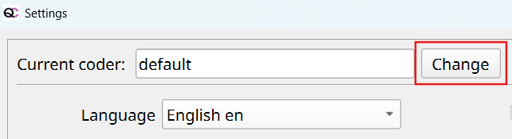{fig-alt="The top of QualCoder's Settings window. Current coder shows default, and the Change button next to it is boxed in red. Below it is the Language setting, English en."}

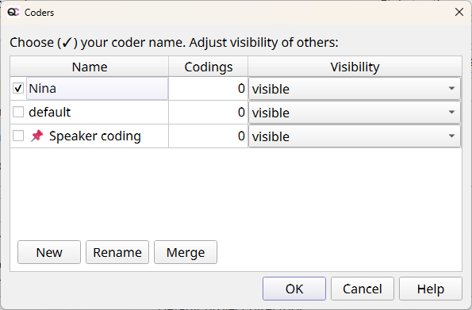{fig-alt="QualCoder's Coders window: Choose your coder name. Three names are listed: Nina, with a check mark, default and Speaker coding, each with 0 codings and visible. Below are New, Rename and Merge buttons, and OK, Cancel and Help." width="55%"}

## Turn on backups to your backups folder

QualCoder can keep backups of your project for you. Point it at the `backups` folder you made.

::: {.panel-tabset group="os"}

### Mac

::: callout-note
## In QualCoder: set the backup folder

1. Go to **Qualcoder > Preferences...** (or **Cmd + ,**).
2. Click **Default project directory**.
3. Go to `qualcoder-workshop` and click **once** on `backups` to select it (don't double-click
   into it).
4. Click **Open**.
5. Click **OK**.
:::

{fig-alt="A Mac folder picker open over QualCoder's Settings window. It shows the qualcoder-workshop folder with three folders: backups (selected), data and intro-qc-workshop.qda. The Open button is at the lower right. Behind it, the Settings window shows the Default project directory button with a path ending in qualcoder-workshop/backups below it." width="80%"}

### Windows

::: callout-note
## In QualCoder: set the backup folder

1. Go to **Project > Settings** (or **Alt + S**).
2. Click **Default project directory**.
3. Go to `qualcoder-workshop` and click **once** on `backups` to select it (don't double-click
   into it).
4. Click **Select Folder**.
5. Click **OK**.
:::

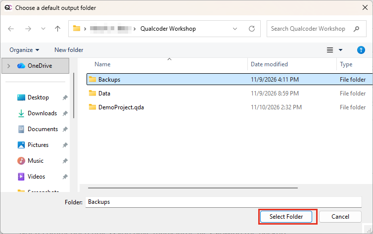{fig-alt="A Windows folder picker titled Choose a default output folder. The project folder holds Backups (selected), Data and DemoProject.qda. The Folder box reads Backups, and the Select Folder button is boxed in red." width="70%"}

:::

QualCoder makes a backup each time you open the project and keeps up to 5 backups in this folder.
When it saves a new one, it deletes the oldest. Backups are folders named like
`intro-qc-workshop_BKUP_<date>_<hour>.qda`. Your first one appears the next time you open the
project; you'll see it at the end of the session (@sec-close).

## Confirm your settings

When you click **OK** to close the settings, QualCoder reports the project settings and any
changes in the **Action Log** tab. It updates every time you change the project.

::: callout-note
## In QualCoder: check the Action Log

1. Click the **Action Log** tab.
2. Check that **Coder** shows your coder name and **Working directory** ends with
   `qualcoder-workshop/backups`.
:::

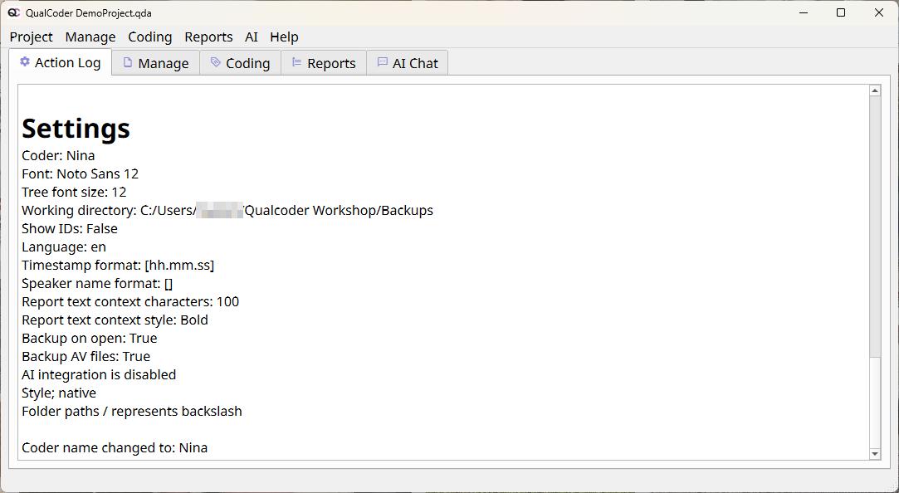{fig-alt="The Action Log tab under the heading Settings. It lists Coder: Nina, the font, a Working directory path ending in Qualcoder Workshop/Backups, Backup on open: True and other settings. The last line reads Coder name changed to: Nina." width="90%"}

# Import transcripts {#sec-import}

## Import the files

QualCoder copies each file into the project. Later edits in QualCoder change only that copy; your
original in `data/` stays as it was.

::: callout-note
## In QualCoder: import transcripts

1. In the top menu, click **Manage > Manage Files**. This opens the **Manage** tab.
2. Click the **Import file into project folder** button.
3. QualCoder opens its own **Open file** window. Go to the `data` folder inside
   `qualcoder-workshop`.
4. Select all three transcripts: click the first, then hold **Shift** and click the last.
5. Click **Open**.
:::

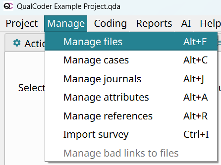{fig-alt="QualCoder's Manage menu open with Manage files (Alt+F) highlighted. The other items are Manage cases, Manage journals, Manage attributes, Manage references, Import survey and a greyed-out Manage bad links to files." width="60%"}

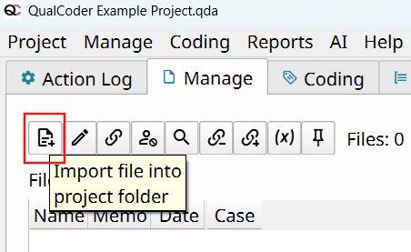{fig-alt="The Manage tab in QualCoder. The first button in its toolbar, a page with a plus sign, is boxed in red, with the tooltip Import file into project folder. The file count reads Files: 0." width="60%"}

{fig-alt="QualCoder's Open file window. Look in shows a path ending in qualcoder-workshop/data. Three files are selected: AliciaKeys.txt, CyndiLauper.txt and DollyParton.txt, all text/plain. The File name box lists all three, and the Open button is at the lower right." width="80%"}

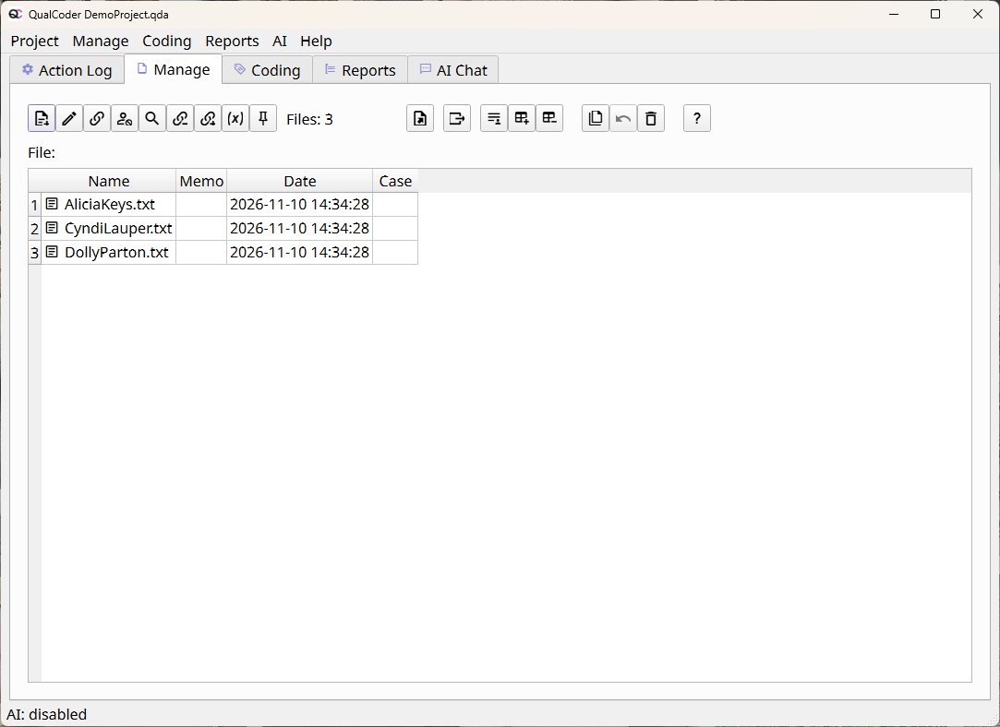{fig-alt="The Manage tab with Files: 3. A table lists AliciaKeys.txt, CyndiLauper.txt and DollyParton.txt, each with its import date, and empty Memo and Case columns." width="80%"}

## Add attributes

Attributes describe your files: for example, the participant's role, the interview date or the
site. They help you keep track of which file is which, and you can use them to filter reports.

We'll add two attributes to the interviews: the singer's **Genre** (text) and the **Year** of the
recording (a number).

| File | Genre | Year |
|------|-------|-----:|
| DollyParton.txt | Country | 1971 |
| CyndiLauper.txt | Pop | 1983 |
| AliciaKeys.txt | R&B | 2001 |

::: callout-note
## In QualCoder: create two attributes

1. In the top menu, go to **Manage > Manage Attributes**.
2. Click the **(x)** button to add an attribute.
3. In the **Add Attribute** window, type `Genre`, choose **Character** (text) and click **OK**.
4. In the **Assign attribute** window, choose **Files** (an attribute can also describe cases or
   journals) and click **OK**.
5. Click **(x)** again. Type `Year`, choose **Numeric** and click **OK**. Choose **Files** and
   click **OK**.
:::

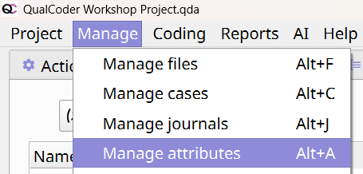{fig-alt="QualCoder's Manage menu open with Manage attributes (Alt+A) highlighted, below Manage files, Manage cases and Manage journals." width="60%"}

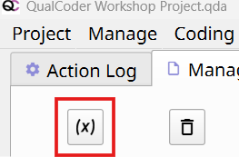{fig-alt="The attributes tab with two buttons: an (x) button boxed in red, and a trash can button." width="40%"}

::: {layout-ncol="2"}
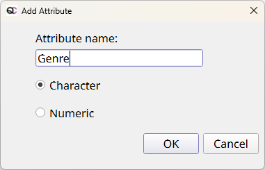{fig-alt="The Add Attribute window with Genre typed as the attribute name and Character selected instead of Numeric, above OK and Cancel buttons."}

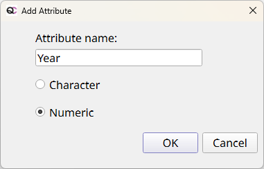{fig-alt="The Add Attribute window with Year typed as the attribute name and Numeric selected instead of Character, above OK and Cancel buttons."}
:::

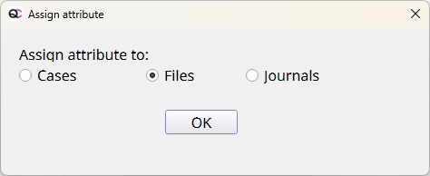{fig-alt="The Assign attribute window: Assign attribute to Cases, Files or Journals, with Files selected, and an OK button." width="45%"}

::: callout-note
## In QualCoder: fill in the attribute for each file

1. Click **Manage > Manage Files**. Each attribute is now a column.
2. Click the cell for each file and type its value from the table above. To edit a value,
   double-click the cell.
:::

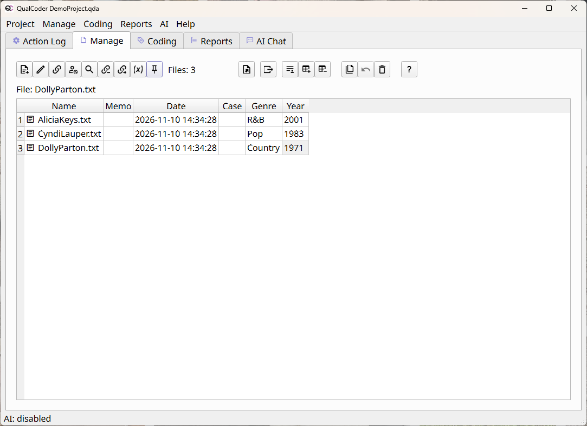{fig-alt="The Manage tab listing the three transcripts with two new columns: AliciaKeys.txt R&B 2001, CyndiLauper.txt Pop 1983 and DollyParton.txt Country 1971." width="80%"}

::: callout-tip
## Extra: put attributes in your own order

QualCoder lists attributes alphabetically. To set your own order, number them: "1. Year",
"2. Genre".
:::

# Code your transcripts {#sec-coding}

## Get ready to code

::: callout-note
## In QualCoder: open a transcript for coding

1. In the top menu, click **Coding > Code Text**. This opens the **Coding** tab.
2. Check that it shows **your name** as the coder. If it doesn't, click the **...** box next to
   the coder name and choose your name. (If your name isn't there, add it in the settings:
   see @sec-project.)
3. Click the name of the transcript you want to code. Its text appears in the large box on the
   right.
:::

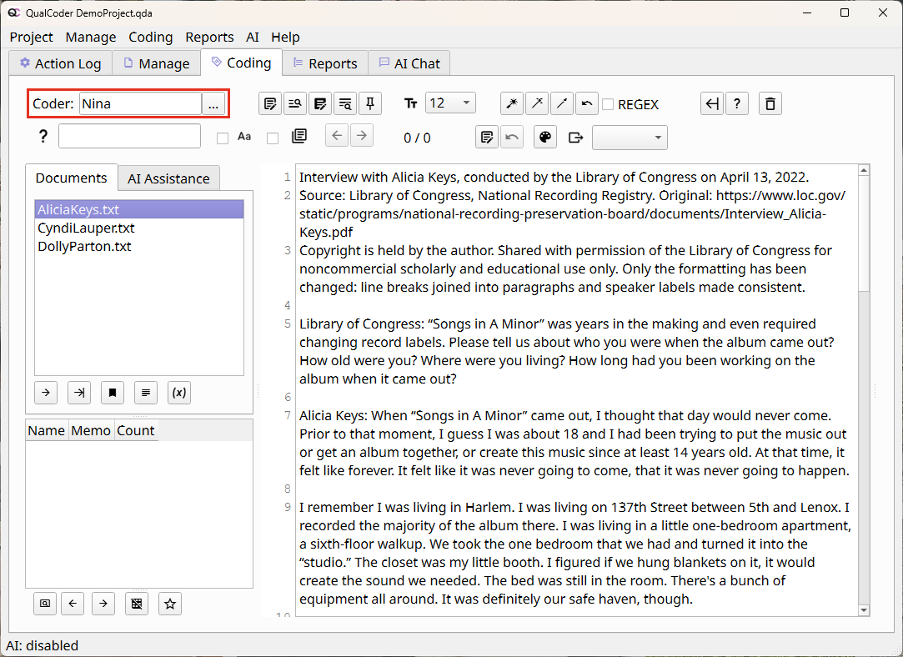{fig-alt="QualCoder's Coding tab. The Coder box, reading Nina, is boxed in red. On the left, the Documents list shows AliciaKeys.txt (selected), CyndiLauper.txt and DollyParton.txt, above an empty codes list. On the right is the Alicia Keys interview, starting with its source and copyright lines."}

## Demo: coding with example codes {#sec-demo}

Watch first, then try it. We'll code part of the Cyndi Lauper interview together, with four
example codes that fit our research question. Each code has a short definition, so everyone (and
your future self) applies it the same way.

| Code | Use it when the singer... | Where to look, for example |
|------|---------------------------|----------------------------|
| **Inspiration from life** | ties a song to something that happened to them or people they know | Cyndi Lauper on the loud clock behind "Time After Time" |
| **Industry pushback** | describes the record company, managers or radio disagreeing with them, or them pushing back | Cyndi Lauper on choosing her first single |
| **Faith/spirituality** | mentions God, faith or a spiritual feeling | Alicia Keys on the chorus of "Troubles" |
| **Why it connects** | explains why listeners relate to the song | Dolly Parton on why "Coat" became so dear to people |

A list of codes like this, with definitions and examples, is a **codebook**. In your own research
you'd build and revise it as you read.

Highlight the text you want to code, then use a keyboard shortcut or right-click:

| To do this | Shortcut | Or right-click and choose |
|------------|----------|---------------------------|
| Code with a **new** code | **Shift + N** | **Mark with new code (N)** |
| Code with a **recently used** code | **Shift + R** | **Mark with recent code (R)**, then pick from the list |
| **Remove** a code from text | **Shift + U** | **Unmark (U)** |

The shortcuts are the same on Mac and Windows [confirm on a Mac]{.tbd}.

::: callout-note
## In QualCoder: code a passage

1. Open **CyndiLauper.txt**.
2. Highlight her answer about where "Time After Time" came from (the clock and the watch).
3. Press **Shift + N**, type `Inspiration from life` and click **OK**. The passage is
   highlighted in the code's color, and the code appears in the codes list on the lower left.
4. Add the other three codes the same way, each on a passage that fits it.
5. Highlight another passage that fits a code you've already made, press **Shift + R** and pick
   the code from the list.
6. To remove a code, click in the coded text and press **Shift + U**.
:::

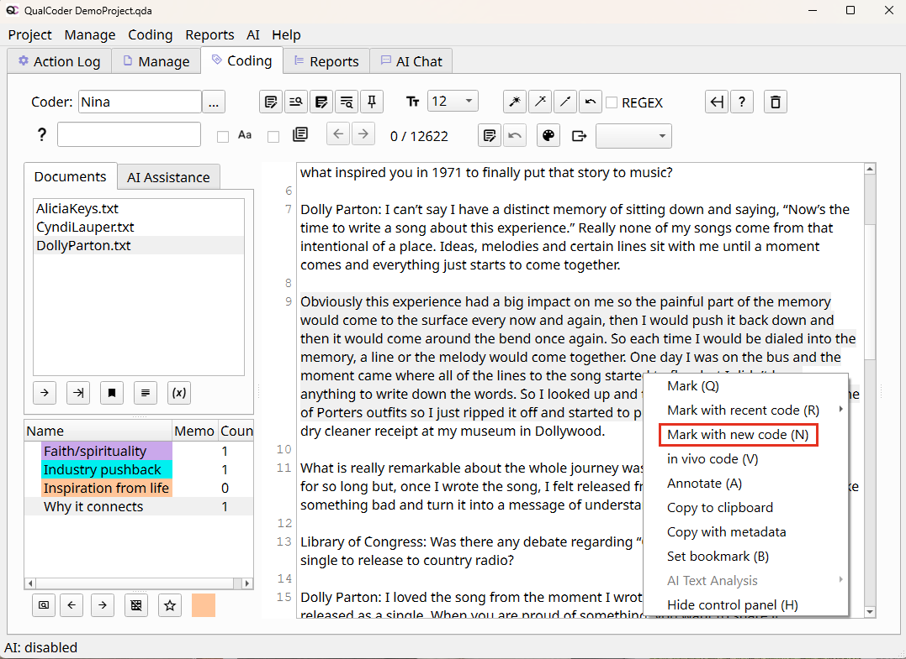{fig-alt="The Coding tab with a passage of the Dolly Parton interview highlighted and a right-click menu open. The menu lists Mark (Q), Mark with recent code (R), Mark with new code (N), boxed in red, in vivo code (V), Annotate (A), Copy to clipboard, Copy with metadata, Set bookmark (B), a greyed-out AI Text Analysis and Hide control panel (H). The codes list on the left shows Faith/spirituality, Industry pushback, Inspiration from life and Why it connects."}

Right-click in the codes list to rename a code, change its color, add a memo to it, add a new code
or category, or delete it.

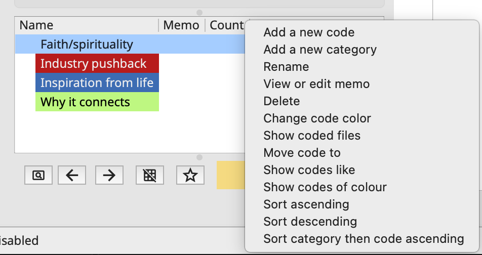{fig-alt="The codes list with five codes, each highlighted in its own color: Autonomy, Edu Background, Goals, Lessons Learned and Mgmt Influence. A right-click menu is open, listing Add a new code, Add a new category, Rename, View or edit memo, Delete and Change code color." width="60%"}

## Do it yourself: 5 minutes of coding {#sec-diy}

::: callout-note
## In QualCoder: your turn (5 minutes)

1. Open **DollyParton.txt**. It's the shortest of the three.
2. Read it and code passages with the four example codes. If you'd like to, add one code of your
   own.
3. Try coding one passage with two codes, so it's underlined.
4. Pick a passage you've coded and add a memo to it (see the next section).
5. Finished early? Code some of the Alicia Keys interview, so your reports have more to show.
:::

## Memos {#sec-memos}

A memo is a note attached to coded text. After you code a passage, add a memo that sums it up:
what about this text helps answer your research question? For example, on a passage coded
*Inspiration from life*: "Turns a painful memory into a song; writing it helped her let go of the
hurt." Later you can run a report of only memos (@sec-reports), which gives you a head start on
writing your analysis.

::: callout-note
## In QualCoder: memo coded text

1. Code the text first.
2. Click anywhere in the coded text.
3. Press **Shift + M**, or right-click and choose **Memo coded text (M)**.
4. Type your memo and click **OK**. The memo'd text is now *italicized*.
:::

If the text has more than one code, QualCoder asks which code the memo belongs to. That choice
decides where the memo shows up in reports.

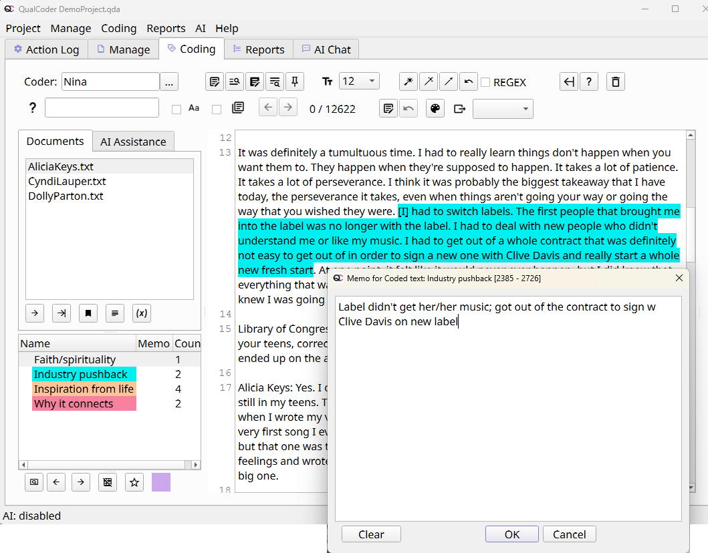{fig-alt="The Coding tab with a passage of the Alicia Keys interview highlighted in the color of the code Industry pushback. A window titled Memo for Coded text: Industry pushback is open over it, with the memo: Label didn't get her/her music; got out of the contract to sign w Clive Davis on new label. Below are Clear, OK and Cancel buttons."}

## Annotations

An annotation explains a piece of text: an acronym, short-hand or a reference a reader wouldn't
know. Unlike a memo, the text doesn't need to be coded. For example, Dolly Parton mentions
"Porter": an annotation can say that's Porter Wagoner, the country singer she performed with at
the time.

::: callout-note
## In QualCoder: annotate text

1. Highlight the text that needs explaining.
2. Press **Shift + A**, or right-click and choose **Annotate (A)**.
3. Type the annotation and click **OK**. The annotated text is now **bold**.
:::

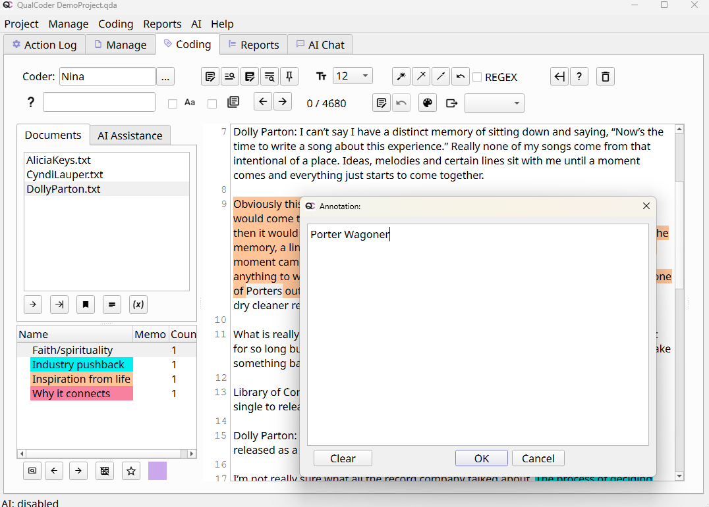{fig-alt="The Coding tab with the Dolly Parton interview open. Over it is a window titled Annotation, containing the text Porter Wagoner, with Clear, OK and Cancel buttons. Behind it, the passage that mentions Porters outfits is highlighted in a code's color."}

## What the formatting means

| What you see | What it means |
|--------------|---------------|
| Highlighted and <u>underlined</u> | The text has 2 or more codes. |
| Highlighted and *italicized* | A memo is attached to the coded text. |
| **Bold** | An annotation is attached to the text. |

In the codes list (lower left of the Coding tab), drag codes to merge them, move them into a
category or reorder them. In the color picker, colors marked with an asterisk (\*) are already
used by a code; hover over one to see which.

# Run reports {#sec-reports}

A report pulls together all the text for the codes and files you choose. We'll start with
everything: all the codes in all three interviews. Then we'll add memos to the report.

::: {.panel-tabset group="os"}

### Mac

::: callout-note
## In QualCoder: report all your coded text

1. In the top menu, click **Reports > Coding reports** [confirm the menu path]{.tbd}.
2. Select all three transcripts: click the first, then hold **Shift** and click the last. (To
   pick only some, hold **Cmd** and click each one.)
3. Select all the codes, the same way.
4. Leave the memo drop-down at **None**.
5. Click the large **Play** button at the top.
:::

### Windows

::: callout-note
## In QualCoder: report all your coded text

1. In the top menu, click **Reports > Coding reports** [confirm the menu path]{.tbd}.
2. Select all three transcripts: click the first, then hold **Shift** and click the last. (To
   pick only some, hold **Ctrl** and click each one.)
3. Select all the codes, the same way.
4. Leave the memo drop-down at **None**.
5. Click the large **Play** button at the top.
:::

:::

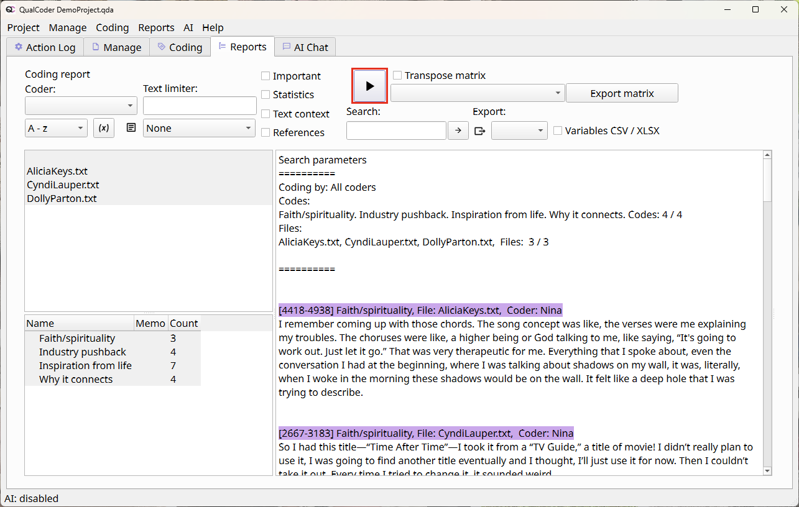{fig-alt="The Reports tab with Coding report at the top and the memo drop-down set to None. All three transcripts are selected on the left, and all four codes below them, with their counts. The Play button is boxed in red. On the right, the report lists its search parameters (all coders, codes 4 of 4, files 3 of 3), then each coded passage under a colored heading, starting with Faith/spirituality in AliciaKeys.txt."}

## Include memos, or only memos

The memo drop-down (it says **None** to start) decides whether memos are in the report. There are
two kinds of memo: memos on **coded text**, like the summaries you wrote today, and memos on
**codes** themselves (right-click a code, **View or edit memo**), which work like a codebook to
remind you what each code means.

| Choose | The report shows |
|--------|------------------|
| **None** | All the coded text, no memos. |
| **Also code memos** | All the coded text, plus the memos on your codes. |
| **Also coded memos** | All the coded text, plus the memos on coded text: the summaries that give you a head start on analysis. |
| **Also all memos** | All the coded text, plus both kinds of memo. |
| **Only memos** | Both kinds of memo, and no coded text. |
| **Only coded memos** | Only the memos on coded text, and no coded text. |

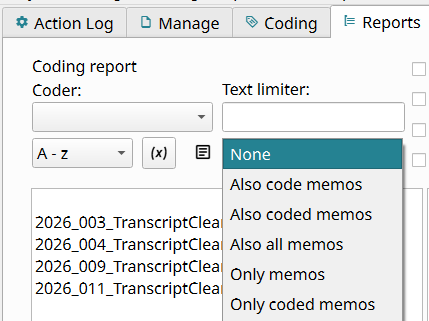{fig-alt="The Reports tab with Coding report at the top. A drop-down is open with six options: None (selected), Also code memos, Also coded memos, Also all memos, Only memos and Only coded memos. File names are listed on the left." width="60%"}

::: callout-note
## In QualCoder: add your memos to the report

1. Keep all the transcripts and codes selected.
2. In the memo drop-down, choose **Also coded memos**.
3. Click **Play**. Your memos now appear with the text they're attached to.
:::

::: callout-note
## In QualCoder: report only your memos

1. In the memo drop-down, choose **Only coded memos**.
2. Click **Play**. The report now lists just your memos: a first draft of your analysis notes.
:::

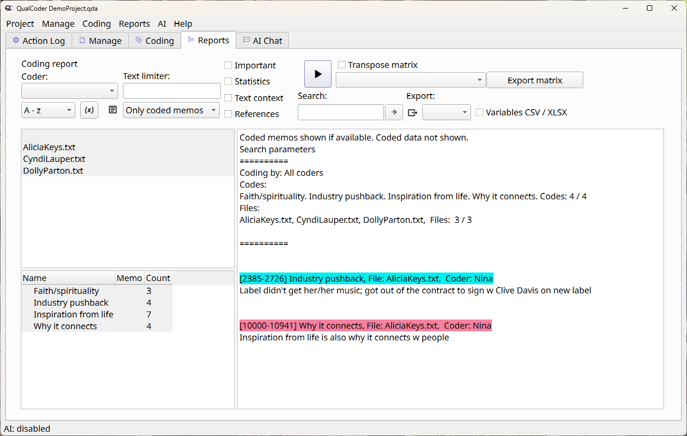{fig-alt="The Reports tab with the memo drop-down set to Only coded memos. The report begins: Coded memos shown if available. Coded data not shown. After the search parameters, it lists two memos, one under Industry pushback and one under Why it connects, both in AliciaKeys.txt."}

## A codes-by-file matrix

A matrix shows which codes appear in which files: codes are columns and files are rows.

::: callout-note
## In QualCoder: make a matrix

1. Keep all the transcripts and codes selected, and set the memo drop-down back to **None**.
2. In the drop-down next to the **Play** button, choose **Codes by file**.
3. Click **Play**. To swap rows and columns, check **Transpose matrix**.
:::

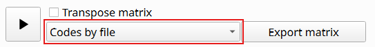{fig-alt="A Play button, with a Transpose matrix check box above a drop-down set to Codes by file, which is boxed in red, and an Export matrix button." width="70%"}

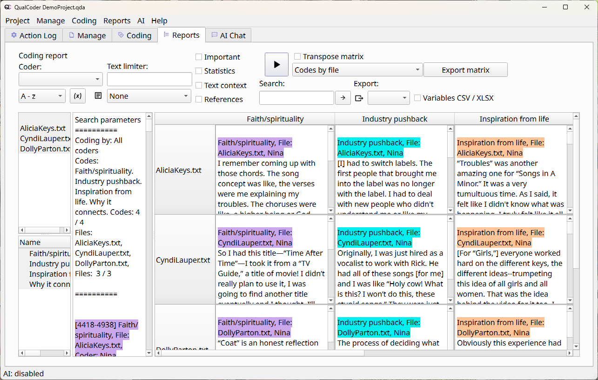{fig-alt="The Reports tab with the matrix drop-down set to Codes by file. A grid has rows for AliciaKeys.txt, CyndiLauper.txt and DollyParton.txt and columns for Faith/spirituality, Industry pushback and Inspiration from life. Each cell shows the coded text for that code in that file, under a heading in the code's color."}

## Try other reports

To get a different report, change what's selected and click **Play** again.

QualCoder has many other report formats and settings. See the
[QualCoder reports documentation](https://qualcoder.org/doc/en/5.3.-Reports/).

# Close your project {#sec-close}

::: callout-warning
## Gotcha: always close the project when you're done

Close the project whenever you're done for the day. An open project is locked, so if it's on a
shared computer or a shared drive, nobody else can open it until you close it. Closing also makes
sure everything is saved before you copy the folder anywhere.
:::

## Close the project

::: {.panel-tabset group="os"}

### Mac

::: callout-note
## In QualCoder: close the project

1. Go to **Project > Close Project** (or **Option + X**).
2. Click the **Action Log** tab. It lists what changed in this session and ends with
   **Closing project**.
:::

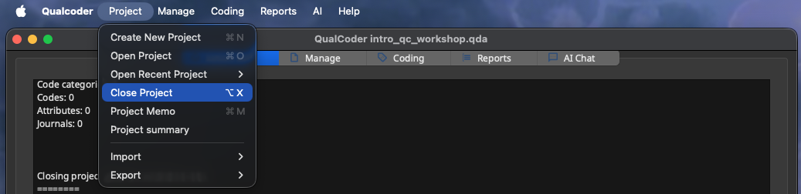{fig-alt="QualCoder's Project menu open in the Mac menu bar, with Close Project (Option X) highlighted. The menu also lists Create New Project, Open Project, Open Recent Project, Project Memo, Project summary, Import and Export." width="80%"}

### Windows

::: callout-note
## In QualCoder: close the project

1. Go to **Project > Close Project** (or **Alt + X**).
2. Click the **Action Log** tab. It lists what changed in this session and ends with
   **Closing project**.
:::

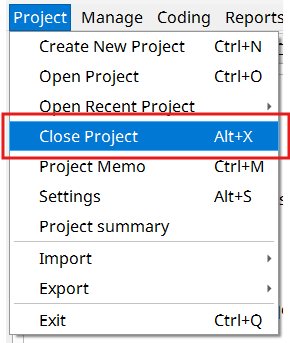{fig-alt="QualCoder's Project menu open with Close Project (Alt+X) boxed in red. Exit (Ctrl+Q) is at the bottom of the menu." width="50%"}

:::

## Reopen the project and find your backup

QualCoder makes a backup when you open a project, so reopening it now creates your first backup
in the `backups` folder.

::: callout-note
## In QualCoder: reopen the project

1. Go to **Project > Open Recent Project** and choose `intro-qc-workshop.qda`.
2. Click the **Action Log** tab. Look for **Project backup created**, followed by the backup's
   location in `qualcoder-workshop/backups` and its name, such as
   `intro-qc-workshop_BKUP_20261106_10.qda` (the date and the hour).
:::

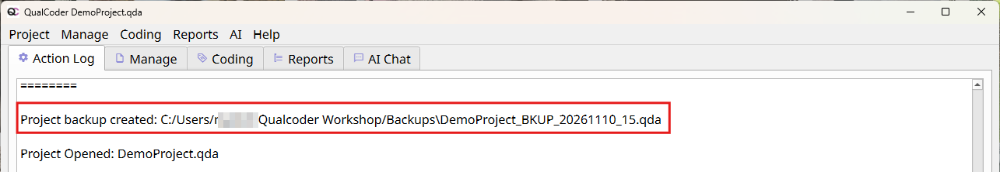{fig-alt="The top of the Action Log tab. A line boxed in red reads Project backup created, followed by a path to the Backups folder and a backup named DemoProject_BKUP_20261110_15.qda. Below it: Project Opened: DemoProject.qda."}

## Close it again and quit

::: {.panel-tabset group="os"}

### Mac

::: callout-note
## In QualCoder: close the project and quit

1. Go to **Project > Close Project** (or **Option + X**).
2. Quit QualCoder: **Qualcoder > Quit Qualcoder** (or **Cmd + Q**).
:::

### Windows

::: callout-note
## In QualCoder: close the project and exit

1. Go to **Project > Close Project** (or **Alt + X**).
2. Exit QualCoder: **Project > Exit** (or **Ctrl + Q**).
:::

:::

# QualCoder resources {#sec-resources}

::: {.golink .golink-left}
[NC State University Libraries Data Science Services: contact us, book an appointment, or
reserve a workstation (with QualCoder installed!) at]{.golink-label}
[go.ncsu.edu/getdatahelp](https://go.ncsu.edu/getdatahelp)
:::

- [QualCoder documentation](https://qualcoder.org/doc/en/): the full manual.
- [Coding text](https://qualcoder.org/doc/en/4.1.-Coding-Text/) and
  [Reports](https://qualcoder.org/doc/en/5.3.-Reports/) in the documentation.
- The Library of Congress [index of Recording Registry
  interviews](https://www.loc.gov/programs/national-recording-preservation-board/recording-registry/index-of-interviews/):
  more than 100 more interviews with musicians, producers and songwriters to practice on.

## References {#sec-references .unnumbered}

Library of Congress. (2016, February 19). *Interview with Dolly Parton* [Interview transcript].
National Recording Preservation Board, National Recording Registry.
<https://www.loc.gov/static/programs/national-recording-preservation-board/documents/DollyPartonInterview.pdf>

Library of Congress. (2019, May 24). *Interview with Cyndi Lauper* [Interview transcript].
National Recording Preservation Board, National Recording Registry.
<https://www.loc.gov/static/programs/national-recording-preservation-board/documents/CyndiLauperInterview.pdf>

Library of Congress. (2022, April 13). *Interview with Alicia Keys* [Interview transcript].
National Recording Preservation Board, National Recording Registry.
<https://www.loc.gov/static/programs/national-recording-preservation-board/documents/Interview_Alicia-Keys.pdf>

The plain-text copies used in this workshop are in the [`data` folder of this guide's
repository](https://github.com/NCSU-Libraries/intro-qualcoder/tree/main/data). Copyright is held
by the authors; they are shared with permission of the Library of Congress for noncommercial
scholarly and educational use only.

# Extra activities {#sec-extras .unnumbered}

These are in the QualCoder Quick Start guide but not in today's session. Try them on the workshop
project, or come back to them when you start your own.

## Working as a team {#sec-team .unnumbered}

A QualCoder project can't be opened by two people at once, so decide **how** you'll work
together before you create the project.

**Working one at a time (sequentially).** Only one person works on the project at any moment.
Either:

- Do all the coding on one computer, used by one person at a time, or
- Code on several computers and pass the project on: close it, zip the `.qda` folder and send it
  to the next person.

**Working at the same time (in parallel).** Each person has their own project folder.

- The transcripts imported into each project can be exactly the same, or each person can take a
  share.
- Ideally, agree on the codes before you start. It's fine if you don't, but then documenting your
  codes is extra important.
- You can share project folders with each other when you want to.

Either way, agree as a team on where project files will live and how to name each person's
project folder. If the team has several deliverables, a subfolder per deliverable helps. Set a
different coder name for each person (@sec-project), and keep a shared list of which color goes
with which code.

To see what one person coded, run a report (@sec-reports) and choose their name from the
**Coder** drop-down at the top left of the report window.

## Open an existing project {.unnumbered}

QualCoder may open your most recent project when it starts. If it doesn't:

::: callout-note
## In QualCoder: open a project

1. Click **Project > Open Project**, go to your project folder, click once on the `.qda` folder
   and click **Select Folder** (Mac: [button name]{.tbd}).
2. Or click **Project > Open Recent Project** and choose the project.
:::

Each time you open QualCoder, check that you're in the right project.

## Fix a typo in a transcript {.unnumbered}

If you spot an error in a transcript (for example, "force plan" where the speaker said "forest
plan"), you can fix it in QualCoder.

::: callout-note
## In QualCoder: edit transcript text

1. In the Coding tab, click the **Edit Text** button. Text that's already coded is underlined.
2. Make your changes. Keep edits small: single words, short phrases or punctuation.
3. Click **End Edit Text** when you're done.
:::

The change is made only in the project's copy of the transcript; the original file isn't
changed. For anything bigger, clean the file (in Word, for example) *before* you import it.

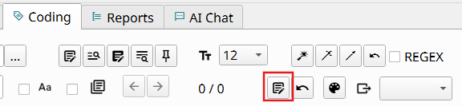{fig-alt="The Coding tab's toolbar. A button showing a page with a pencil is boxed in red, next to a 0 / 0 counter, an undo button and a color palette button."}

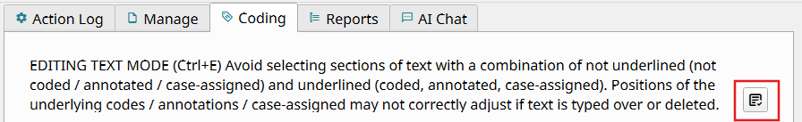{fig-alt="The Coding tab in editing mode with the message: EDITING TEXT MODE (Ctrl+E) Avoid selecting sections of text with a combination of not underlined (not coded / annotated / case-assigned) and underlined (coded, annotated, case-assigned). Positions of the underlying codes / annotations / case-assigned may not correctly adjust if text is typed over or deleted. The edit button is boxed in red."}

## Memo a whole file {.unnumbered}

Use a file memo to track progress, such as "Coded, 10/1/26".

::: callout-note
## In QualCoder: add a file memo

1. Go to **Manage > Manage Files**.
2. Click once in the **Memo** column for the file and type your memo.
:::

## More coding shortcuts {.unnumbered}

| New code | Quick code | Recent code | Uncode |
|:--------:|:----------:|:-----------:|:------:|
| Shift + N | Shift + Q | Shift + R | Shift + U |
| **Add memo** | **Annotate** | **Mark important** | **Bookmark** |
| Shift + M | Shift + A | Shift + I | Shift + B |

- **Quick code (Shift + Q)** applies the same code you used last.
- **Shift + ←** and **Shift + →** extend coded text to the left or right. QualCoder can be slow
  at this; it's often quicker to uncode and recode the passage.
- The color picker has options for color vision deficiencies.

## Code other kinds of files {.unnumbered}

QualCoder can code PDFs, images, audio and video, not just text. See [Coding
text](https://qualcoder.org/doc/en/4.1.-Coding-Text/) and the rest of the
[documentation](https://qualcoder.org/doc/en/).

## QualCoder's AI features {.unnumbered}

QualCoder can work with AI tools to help search and code your data. Before you turn this on,
check with your advisor and your IRB: sending research data to an AI service may not be allowed
under your protocol. See the [QualCoder documentation](https://qualcoder.org/doc/en/).
